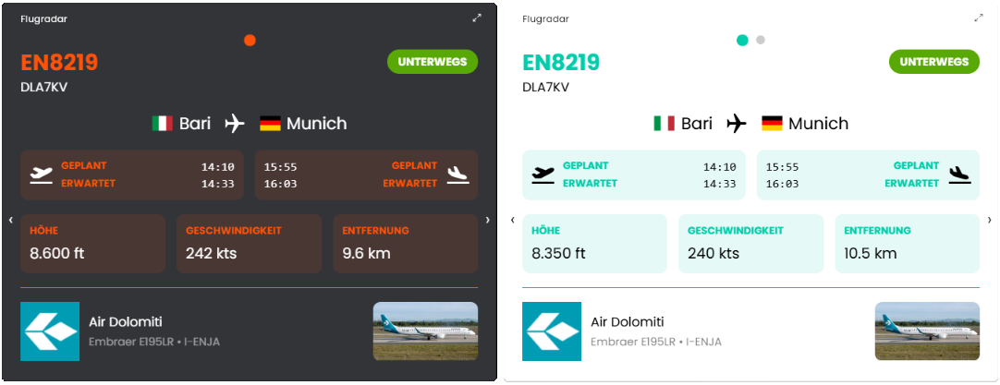

# 🛰️ Flugradar (Flight Radar)

Das Modul empfängt Flugdaten über MQTT vom Service [flights2mqtt](https://github.com/Wilkware/flights2mqtt) und stellt sie in der TileVisu übersichtlich dar.

## Inhaltverzeichnis

1. [Funktionsumfang](#user-content-1-funktionsumfang)
2. [Voraussetzungen](#user-content-2-voraussetzungen)
3. [Installation](#user-content-3-installation)
4. [Einrichtung](#user-content-4-einrichtung)
5. [Statusvariablen](#user-content-5-statusvariablen)
6. [Darstellungen](#user-content-6-darstellungen)
7. [Visualisierung](#user-content-7-visualisierung)
8. [Befehlsreferenz](#user-content-8-befehlsreferenz)
9. [Versionshistorie](#user-content-9-versionshistorie)

### 1. Funktionsumfang

Mit diesem Modul können Flugdaten aus dem MQTT-Service [flights2mqtt](https://github.com/Wilkware/flights2mqtt) direkt in der TileVisu angezeigt werden.  
Nach der Installation und Konfiguration des Services kann das Modul das gewünschte MQTT-Topic abonnieren und die aktuellen Flugbewegungen übersichtlich darstellen.  
Zusätzlich lässt sich die Haltezeit der Flugdaten im Modul einstellen, sodass die Anzeige immer aktuell bleibt, ohne dass ältere Daten sofort verschwinden.

### 2. Voraussetzungen

* Symcon ab Version 8.1

Notwendige Voraussetzung ist eine funktionsfähige und laufende Installation von [flights2mqtt](https://github.com/Wilkware/flights2mqtt). Dessen Installation, Konfiguration und der Betrieb ist hier beschrieben: [README](https://github.com/Wilkware/flights2mqtt/blob/main/README.md).

### 3. Installation

* Über den Modul Store das Modul _Flugradar_ installieren.
* Alternativ über das Modul Control folgende URL hinzufügen.  
`https://github.com/Wilkware/FlightRadar` oder `git://github.com/Wilkware/FlightRadar.git`

### 4. Einrichtung

* Unter 'Instanz hinzufügen' ist das _Flugradar_-Modul unter dem Hersteller '(Geräte)' aufgeführt.

__Konfigurationsseite__:

Einstellungsbereich:

> ✈️ Flugdaten ...

Name                        | Beschreibung
--------------------------- | ----------------------------------
MQTT Base Topic             | Ist das grundlegende Themenpräfix, unter dem alle spezifischen Subtopics für Nachrichten in einem MQTT-System organisiert werden. Standardmäßig ist der Präfix auf _'flights'_ vorbelegt.
MQTT Topic                  | Ist der eindeutige Pfad, der zum Veröffentlichen und Abonnieren von Nachrichten verwendet wird.

__HINWEIS:__ Immer in Kleinbuchstaben angeben!

> ⏱️ Zeitsteuerung ...

Name                        | Beschreibung
--------------------------- | ----------------------------------
Ablaufzeit                  | Legt die Haltezeit der Flugdaten in Minuten fest. Die Flüge werden so lange angezeigt, auch wenn sie nicht mehr im definierten Flugbereich auftreten.

### 5. Statusvariablen

Es werden keine Statusvariablen angelegt.

### 6. Darstellungen

Es werden keine Darstellungen oder Profile benötigt.

### 7. Visualisierung

Das Modul kann direkt oder als Link in die TileVisu eingehangen werden.  
Jeder Flug wird pro Kachel angezeigt und es kann durch die einzelnene Flüge durchnavigieren.

### 8. Befehlsreferenz

Das Modul stellt keine direkten Funktionsaufrufe zur Verfügung.

### 9. Versionshistorie

v1.0.20260110

* _NEU_: Initialversion

## Entwickler

Seit nunmehr über 10 Jahren fasziniert mich das Thema Haussteuerung. In den letzten Jahren betätige ich mich auch intensiv in der Symcon Community und steuere dort verschiedenste Skript und Module bei. Ihr findet mich dort unter dem Namen @pitti ;-)

## Spenden

Die Software ist für die nicht kommerzielle Nutzung kostenlos, über eine Spende bei Gefallen des Moduls würde ich mich freuen.

## Lizenz

Namensnennung - Nicht-kommerziell - Weitergabe unter gleichen Bedingungen 4.0 International

